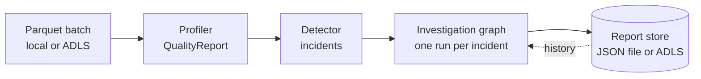
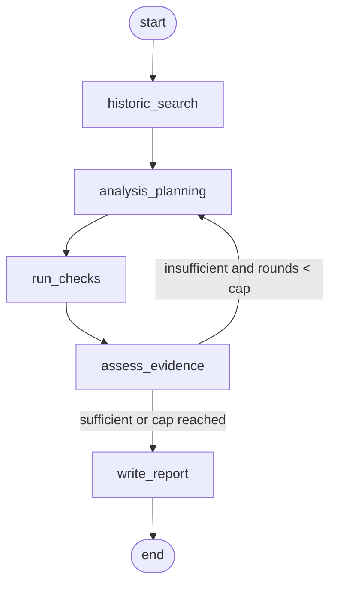

# Architecture

DataOps Copilot profiles a batch of data, detects quality-policy violations, and
runs a root-cause investigation for each one. Investigations are performed by a
LangGraph loop in which Claude plans and judges, but every data access goes
through a fixed catalog of read-only Spark checks. The model never writes or
runs code.

## End-to-end flow



`POST /scans` (or `python -m dataops_copilot scan`) runs this whole flow.
`POST /investigations` runs only the graph, for one incident you already have.

## Investigation loop



| Node | What it does | LLM? |
| --- | --- | --- |
| `historic_search` | Loads past RCA reports for the same metric and ranks them by shared column and dataset. | No |
| `analysis_planning` | Claude proposes up to 3 hypotheses, each with typed `PlannedCheck`s from the catalog. Later rounds see prior results and open questions. | Yes |
| `run_checks` | Runs each new planned check once against the batch. Failures (bad column, load error) become failed `CheckResult`s, not exceptions. | No |
| `assess_evidence` | Claude decides whether the metrics support one cause, and lists open questions if not. | Yes |
| `write_report` | Claude drafts the `RCAReport`; the node then sets the factual fields from state (history count, executed checks) and forces escalation with low confidence when evidence was never sufficient. | Yes |

The round cap is `DATAOPS_MAX_ITERATIONS` (default 3).

## Check catalog

| Check | Parameters | Metrics |
| --- | --- | --- |
| `value_range` | `column` | min, max, row_count, negative_count, null_count |
| `breakdown_by` | `column`, `group_by`, `condition` (`negative`, `non_positive`, `null`) | matching rows per group, top 25 |
| `duplicate_rows` | none | row_count, distinct_count, duplicate_count, duplicate_rate |

To add a check: write a function returning `CheckResult` in
`src/dataops_copilot/agent/checks/`, add its name to `CheckName` in
`checks/models.py`, add a `case` in `checks/catalog.py`, and describe it in
`CATALOG_DESCRIPTION` so the planner knows it exists.

## Claude integration

All three LLM steps use `langchain-anthropic` with Claude's native structured
outputs (`with_structured_output(..., method="json_schema")`). Forced tool
calling is not used because current models reject it. `PlannedCheck` is a flat
model rather than a discriminated union, because structured outputs do not
enforce `const`; per-check parameter rules are checked when the check runs.

Model and effort come from `DATAOPS_ANTHROPIC_MODEL` (default
`claude-opus-5-5`) and `DATAOPS_ANTHROPIC_EFFORT` (default `medium`).

## Evaluation

`evals/rca_planner_v2.json` holds golden planner cases. Each case lists
`required_checks` as `check_name` or `check_name:column`. Two LangSmith
evaluators score planner output: `read_only_checks` (no mutating language) and
`required_checks` (share of required checks planned).

```bash
uv run python scripts/sync_planner_eval_dataset.py   # create the LangSmith dataset once
uv run python scripts/run_planner_eval.py            # run an experiment
```
