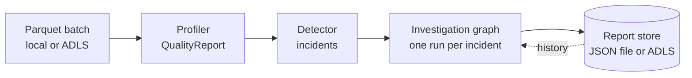

# Architecture

DataOps Copilot profiles a batch of data, detects quality-policy violations,
and runs a root-cause investigation for each one. Investigations run as a
LangGraph loop in which Claude plans and judges, while every data access goes
through a fixed [catalog of read-only Spark checks](checks.md). The model never
writes or runs code.

## End-to-end flow



`POST /scans` (or `python -m dataops_copilot scan`) runs this whole flow.
`POST /investigations` runs only the graph, for one incident you already have.

| Stage | Module | Output |
| --- | --- | --- |
| Load | `agent/services/data_loader.py` | Spark `DataFrame`. Remote `abfss://` or `https://` blobs are downloaded once with `DefaultAzureCredential` and cached by URI digest. |
| Profile | `quality/profiler.py` | `QualityReport`: row count, null rate per column, duplicate rate, negative-fare rate, non-positive trip-distance rate. |
| Detect | `quality/detector.py` | One `DataQualityIncident` for each rate above `QualityPolicy.threshold_rate`. |
| Investigate | `agent/graph.py` | `IncidentRCAReport`. |
| Persist | `agent/services/report_store.py` | Report saved locally or to ADLS. |

## Investigation loop


| Node | What it does | LLM? |
| --- | --- | --- |
| `historic_search` | Loads past RCA reports for the same metric and ranks them by shared column and dataset. | No |
| `analysis_planning` | Claude proposes up to 3 hypotheses, each with typed `PlannedCheck`s from the catalog. Later rounds also see prior results and open questions. | Yes |
| `run_checks` | Runs each new planned check once against the batch. Failures (bad column, load error) become failed `CheckResult`s, not exceptions. | No |
| `assess_evidence` | Claude decides whether the metrics support one cause, and lists open questions if not. | Yes |
| `write_report` | Claude drafts the `RCAReport`. The node then sets the factual fields from state (history count, executed checks), and forces escalation with low confidence when the evidence was never sufficient. | Yes |

The round cap is `DATAOPS_MAX_ITERATIONS` (default 3).

### State

The graph carries one Pydantic `InvestigationState`:

| Field | Written by |
| --- | --- |
| `request` | Caller: the incident, quality report, dataset, batch and `data_uri`. |
| `historical_matches` | `historic_search` |
| `analysis_plan` | `analysis_planning` (latest round) |
| `check_results` | `run_checks`, accumulated across rounds |
| `assessment` | `assess_evidence` (latest round) |
| `iteration_count` | `analysis_planning` |
| `final_result` | `write_report` |

The LLM steps receive narrower views: the planner gets a `PlanningContext`, and
the assessor and report writer get an `InvestigationContext`. Neither includes
loop bookkeeping.

### Dependency injection

`build_investigation_graph(deps)` takes an `InvestigationDependencies`
dataclass: the report store, the data loader, and the planner, assessor and
report-writer callables. Production wires in Claude-backed callables. Tests
pass plain functions, so the whole graph can be tested without network access
or a JVM.

## Claude integration

All three LLM steps use `langchain-anthropic` with Claude's native structured
outputs (`with_structured_output(..., method="json_schema")`). Forced tool
calling is not used, because current models reject a forced `tool_choice`.
`PlannedCheck` is a flat model rather than a discriminated union, because
structured outputs do not enforce `const`; the per-check parameter rules are
checked when the check runs.

The model and effort come from `DATAOPS_ANTHROPIC_MODEL` (default
`claude-opus-5-5`) and `DATAOPS_ANTHROPIC_EFFORT` (default `medium`).

## Storage

`ReportStore` is a small protocol with two implementations:

=== "Local JSON"

    `LocalJsonReportStore` keeps every report in one JSON file
    (`DATAOPS_LOCAL_REPORT_PATH`, default `data/rca_reports.json`). Good for
    development.

=== "ADLS Gen2"

    `AdlsReportStore` writes one blob per report, authenticated with
    `DefaultAzureCredential`:

    ```text
    <container>/rca-reports/<metric>/<dataset>/<batch>/<timestamp>.json
    ```

    History lookups list only the `<metric>/` prefix, so loading history
    stays cheap as the store grows.

Select one with `DATAOPS_REPORT_STORE=local|adls`.
