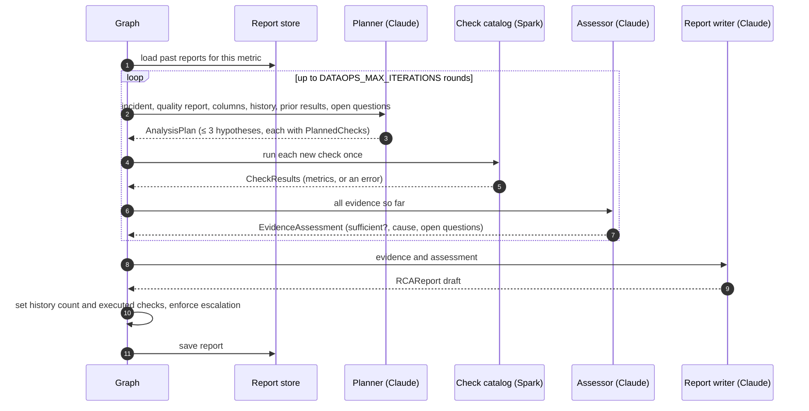

# Demo walkthrough

This page follows one real batch through the system: the
[NYC TLC yellow-taxi trip records](https://www.nyc.gov/site/tlc/about/tlc-trip-record-data.page)
for January 2026, 3,724,889 rows. The scan output and check results below come
from running the code in this repository against that file.

!!! info "Reproduce it"

    Download `yellow_tripdata_2026-01.parquet` from the TLC site into `data/`,
    then follow [Getting started](getting-started.md). Steps 1 and 2 need
    only Java and Spark. Step 3 also needs an Anthropic API key.

## 1. Profile and detect

A scan with `--no-investigate` profiles the batch and applies the policy, with
no Claude calls. It takes about 30 seconds on a laptop.

```bash
uv run python -m dataops_copilot scan \
  --dataset yellow_taxi --batch 2026-01 \
  --data-uri data/yellow_tripdata_2026-01.parquet \
  --no-investigate
```

??? example "Full quality report"

    ```json
    {
      "row_count": 3724889,
      "null_rates": {
        "VendorID": 0.0,
        "tpep_pickup_datetime": 0.0,
        "tpep_dropoff_datetime": 0.0,
        "passenger_count": 0.2921048117138524,
        "trip_distance": 0.0,
        "RatecodeID": 0.2921048117138524,
        "store_and_fwd_flag": 0.2921048117138524,
        "PULocationID": 0.0,
        "DOLocationID": 0.0,
        "payment_type": 0.0,
        "fare_amount": 0.0,
        "extra": 0.0,
        "mta_tax": 0.0,
        "tip_amount": 0.0,
        "tolls_amount": 0.0,
        "improvement_surcharge": 0.0,
        "total_amount": 0.0,
        "congestion_surcharge": 0.2921048117138524,
        "Airport_fee": 0.2921048117138524,
        "cbd_congestion_fee": 0.0
      },
      "duplicate_rate": 0.0,
      "negative_fare_rate": 0.010594409658918695,
      "invalid_trip_distance_rate": 0.03375617367390008
    }
    ```

With the default threshold of 0.1%, the detector raises seven incidents:

| # | Metric | Column | Observed rate |
| --- | --- | --- | --- |
| 1 | `null_rate` | `passenger_count` | 29.21% |
| 2 | `null_rate` | `RatecodeID` | 29.21% |
| 3 | `null_rate` | `store_and_fwd_flag` | 29.21% |
| 4 | `null_rate` | `congestion_surcharge` | 29.21% |
| 5 | `null_rate` | `Airport_fee` | 29.21% |
| 6 | `negative_fare_rate` | `fare_amount` | 1.06% |
| 7 | `invalid_trip_distance_rate` | `trip_distance` | 3.38% |

Five columns with the *identical* null rate already hint at one shared cause,
not five separate faults. The investigation has to show that from the data.

## 2. Gather evidence with the check catalog

During an investigation, Claude plans checks such as the ones below. Each is a
typed `PlannedCheck`, and the result is a `CheckResult` with numeric metrics.
These are real results from the January batch.

=== "Null passenger_count"

    ```json title="breakdown_by(column=passenger_count, group_by=payment_type, condition=null)"
    {
      "check_name": "breakdown_by",
      "params": {"column": "passenger_count", "group_by": "payment_type", "condition": "null"},
      "metrics": {"payment_type=0": 1088058.0},
      "succeeded": true
    }
    ```

    All 1,088,058 null rows (29.21% of 3,724,889) sit in a single payment
    code, `payment_type=0`. The TLC data dictionary lists code 0 as a
    *Flex Fare* trip. Grouping by vendor shows the gap across every vendor
    (`VendorID=2`: 944,635, `VendorID=1`: 139,406, `VendorID=6`: 4,017),
    which points to how one trip type is recorded, not to one faulty
    vendor feed.

=== "Negative fares"

    ```json title="value_range(column=fare_amount)"
    {
      "check_name": "value_range",
      "params": {"column": "fare_amount"},
      "metrics": {"min": -2555.2, "max": 2555.2, "row_count": 3724889.0,
                  "negative_count": 39463.0, "null_count": 0.0},
      "succeeded": true
    }
    ```

    ```json title="breakdown_by(column=fare_amount, group_by=payment_type)"
    {
      "check_name": "breakdown_by",
      "params": {"column": "fare_amount", "group_by": "payment_type"},
      "metrics": {"payment_type=4": 26039.0, "payment_type=2": 8633.0,
                  "payment_type=3": 4492.0, "payment_type=1": 267.0,
                  "payment_type=0": 32.0},
      "succeeded": true
    }
    ```

    The minimum equals the negated maximum (−2555.2 / 2555.2), and two
    thirds of negative fares are `payment_type=4` (*Dispute*). That fits
    reversal or refund records stored with a negative sign, not corrupt
    values.

=== "Non-positive distances"

    ```json title="breakdown_by(column=trip_distance, group_by=VendorID, condition=non_positive)"
    {
      "check_name": "breakdown_by",
      "params": {"column": "trip_distance", "group_by": "VendorID", "condition": "non_positive"},
      "metrics": {"VendorID=2": 114960.0, "VendorID=1": 9953.0, "VendorID=7": 825.0},
      "succeeded": true
    }
    ```

    91% of the 125,738 zero or negative distances come from one vendor.
    That is a lead the assessor can follow up in the next round.

=== "Duplicates"

    ```json title="duplicate_rows()"
    {
      "check_name": "duplicate_rows",
      "params": {},
      "metrics": {"row_count": 3724889.0, "distinct_count": 3724889.0,
                  "duplicate_count": 0.0, "duplicate_rate": 0.0},
      "succeeded": true
    }
    ```

    No exact duplicates, which rules out a double-load as the cause of any
    of the incidents.

=== "A bad plan"

    ```json title="value_range(column=fare_amt)"
    {
      "check_name": "value_range",
      "params": {"column": "fare_amt"},
      "metrics": {},
      "succeeded": false,
      "error": "Column 'fare_amt' does not exist."
    }
    ```

    If the planner names a column that doesn't exist, the check fails
    cleanly. The assessor sees the error, and the next round can plan a
    corrected check.

## 3. Investigate with Claude

Without `--no-investigate`, the scan runs the investigation loop once per
incident:

```bash
uv run python -m dataops_copilot scan \
  --dataset yellow_taxi --batch 2026-01 \
  --data-uri data/yellow_tripdata_2026-01.parquet
```

For each incident, the loop works like this:



A plan is structured JSON, validated by Pydantic. For example, a plan for the
negative-fare incident has this shape:

```json
{
  "analysis_goal": "Explain why 1.06% of fare_amount values are negative.",
  "hypotheses": [
    {
      "likely_cause": "Refunds or disputes stored as negative fares",
      "rationale": "...",
      "likelihood": "high",
      "checks_to_run": [
        {"check_name": "value_range", "column": "fare_amount", "reason": "..."},
        {"check_name": "breakdown_by", "column": "fare_amount",
         "group_by": "payment_type", "condition": "negative", "reason": "..."}
      ]
    }
  ]
}
```

### The report

Each investigation ends in an `IncidentRCAReport`, which holds the original
request and an `RCAReport`:

| Field | Set by | Meaning |
| --- | --- | --- |
| `likely_cause` | Claude | The cause the evidence supports. |
| `confidence` | Claude, capped by code | `low`, `medium` or `high`. Forced to `low` if the evidence was never sufficient. |
| `explanation` | Claude | How the metrics support the cause. |
| `evidence` | Claude | Specific metrics cited from check results. |
| `recommendations` | Claude | Advisory next steps. Nothing is applied automatically. |
| `escalation_required` | Claude, forced by code | Always `true` when the evidence was never sufficient. |
| `previous_similar_incidents` | Code | Number of matching past reports. |
| `analyses_executed` | Code | The checks that actually succeeded, for example `breakdown_by(column=fare_amount, group_by=payment_type)`. |

The report is saved to the report store. The next time a `negative_fare_rate`
incident appears, the planner receives it as a historical match, ranked higher
if it shares the column or the dataset.

## 4. Do the same over HTTP

```bash
task run   # http://127.0.0.1:8000, interactive docs at /docs
```

```bash
curl -s -X POST http://127.0.0.1:8000/scans \
  -H 'content-type: application/json' \
  -d '{"dataset_name": "yellow_taxi", "batch_id": "2026-01",
       "data_uri": "data/yellow_tripdata_2026-01.parquet",
       "investigate": false}'
```

In Azure, `data_uri` points at the lake instead, for example
`abfss://raw@<storage>.dfs.core.windows.net/yellow/2026-01.parquet`. See
[Deploy to Azure](deployment.md).
