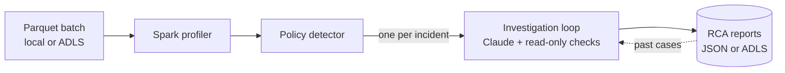

# DataOps Copilot

**Agentic data-quality monitoring and root-cause analysis for an Azure data lake.**

DataOps Copilot profiles each batch that lands in the lake, flags the metrics
that break your quality policy, and investigates every incident. Claude
proposes hypotheses and judges the evidence, but every query against the data
comes from a fixed catalog of read-only Spark checks. The model never writes or
runs code, and it never modifies data.

[See the demo :material-play-circle:](demo.md){ .md-button .md-button--primary }
[Get started :material-rocket-launch:](getting-started.md){ .md-button }

---

## What happens to a batch

-   :material-chart-box-outline:{ .lg .middle } **Profile**

    ---

    Spark computes the row count, the null rate of every column, the duplicate
    rate, negative fares and non-positive trip distances in one pass.

-   :material-alert-decagram-outline:{ .lg .middle } **Detect**

    ---

    Any rate above the policy threshold (0.1% by default) becomes a
    `DataQualityIncident`, tied to the column it affects.

-   :material-graph-outline:{ .lg .middle } **Investigate**

    ---

    A LangGraph loop plans hypotheses, runs checks, assesses the evidence and
    replans until the evidence is enough or the round cap is reached.

-   :material-file-document-check-outline:{ .lg .middle } **Report**

    ---

    An advisory RCA report, saved as history for future investigations. When
    the evidence never becomes sufficient, the report is low confidence and
    asks for a human.

## Results on real data

Running against the January 2026 NYC yellow-taxi batch (3,724,889 trips), the
scan raises seven incidents, and the check catalog narrows them down
immediately:

| Incident | Observed | What one check reveals |
| --- | --- | --- |
| `null_rate` on `passenger_count` (and four other columns) | 29.2% | All 1,088,058 null rows have `payment_type=0`. |
| `negative_fare_rate` on `fare_amount` | 1.06% | 26,039 of 39,463 negative fares have `payment_type=4`. |
| `invalid_trip_distance_rate` on `trip_distance` | 3.38% | 114,960 of 125,738 come from `VendorID=2`. |

The [demo walkthrough](demo.md) follows this batch from start to finish.

## Design principles

!!! abstract "Evidence comes from checks, not from the model"

    Claude chooses *which* checks to run and interprets their metrics. The
    checks themselves are plain, reviewed PySpark functions that only read.
    A bad column name or a load failure becomes a failed result that Claude
    can see, so the investigation never crashes.

!!! abstract "Advisory, with an explicit escape hatch"

    If the assessor never finds the evidence sufficient, the final report
    is forced to `confidence: low` and `escalation_required: true`,
    whatever the model wrote.

!!! abstract "Facts in the report are set by code"

    The number of similar past incidents and the list of analyses run are
    written from the graph state, never by the LLM.

## Built with

PySpark · LangGraph · Claude (Opus 5.5, native structured outputs) ·
FastAPI · Pydantic · Azure Data Lake Storage Gen2 · Azure Container Apps ·
Bicep · LangSmith · uv
